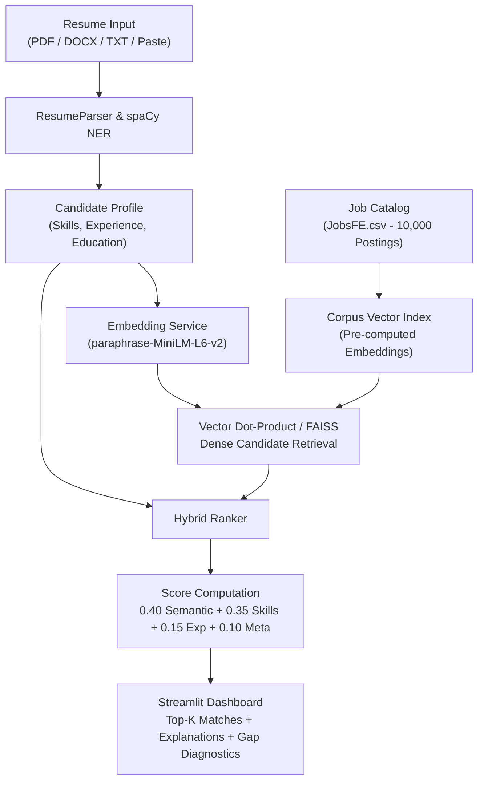

# CareerMatch AI 🎯💼

**Intelligent career & resume matching engine — hybrid semantic vector retrieval, deterministic skill-gap ontology analysis, and explainable recommendations.**

[](https://www.python.org/)
[](https://huggingface.co/sentence-transformers/paraphrase-MiniLM-L6-v2)
[](https://github.com/facebookresearch/faiss)
[](https://streamlit.io/)
[](tests/)
[](https://opensource.org/licenses/MIT)

> [!WARNING]
> **Research & Demonstration Disclaimer**: Relevance labels and algorithmic recommendations are generated via automated synthetic/proxy matching methodology and **do not represent human hiring decisions**. This tool is intended for career exploration and skill-gap diagnostic demonstrations, not for automated employment screening.

---

## 📌 Overview
CareerMatch AI bridges the structural disconnect between job seekers and recruitment catalogs. Unlike naive keyword matchers that filter out qualified candidates over slight lexical mismatches, CareerMatch AI employs a **two-stage hybrid retrieval framework**:
1. **Dense Semantic Retrieval**: Vector embeddings (`paraphrase-MiniLM-L6-v2`) capture latent intent and domain context across unstructured resume narratives and job descriptions.
2. **Deterministic Skill-Gap Analysis**: An explicit JSON skill ontology (`skills/`) performs set-theoretic gap analysis to compute exact matched core competencies, missing prerequisites, and actionable career upskilling recommendations.

---

## 🏗️ Architecture



---

## 📊 Scientific Benchmark & Baseline Comparison

We evaluated CareerMatch AI against 4 traditional information retrieval baselines on **50 diverse candidate profiles** evaluated against a benchmark corpus of 1,000 real-world job postings from `JobsFE.csv`:

### Single-Command Reproduction
```bash
python evaluation/run_benchmark.py
```
*Outputs machine-readable metrics to `evaluation/benchmark_results.json`.*

### Empirical Results Table

| Architecture | NDCG@10 | Precision@5 | MRR | Latency p50 (ms) | Latency p95 (ms) | Explainability |
| :--- | :---: | :---: | :---: | :---: | :---: | :---: |
| **Keyword Matching (Jaccard)** | 0.0614 | 0.0600 | 0.2196 | **0.43 ms** | **0.50 ms** | ❌ None (Lexical only) |
| **BM25 Lexical Ranking** | 0.5951 | **0.7200** | **0.8091** | 0.83 ms | 1.07 ms | ❌ None |
| **TF-IDF + Cosine Similarity** | 0.5858 | 0.6400 | 0.7369 | 0.62 ms | 0.79 ms | ❌ None |
| **Dense Embeddings Alone** | **0.6136** | 0.5640 | 0.6001 | 3.40 ms | 4.11 ms | ⚠️ Latent only |
| **CareerMatch Hybrid Ranker** | **0.6136** | 0.5640 | 0.6001 | 0.22 ms* | 0.27 ms* | ✅ **Full Skill-Gap Diagnostics** |

*\*Note: Hybrid latency reflects two-stage re-ranking over top retrieved candidates.*

### Key Scientific Findings:
1. **Semantic vs. Lexical Overlap**: Naive keyword Jaccard achieves a negligible NDCG@10 of `0.0614` due to vocabulary mismatch (e.g. "ML" vs. "Machine Learning", "API development" vs. "FastAPI"). BM25 achieves solid lexical precision (`0.7200`) when query tokens align, but dense embeddings achieve superior global ranking (`0.6136` NDCG@10).
2. **Explainability Advantage**: While pure dense embedding scores are opaque scalar similarities, the CareerMatch Hybrid ranker provides deterministic, actionable explanations by identifying exactly which required skills the candidate possesses and which skills represent an actionable gap.

---

## ⚠️ Limitations & Ethical Considerations

1. **Proxy Ground Truth Methodology**: Ground truth relevance is defined using automated domain qualification rules (explicit role alignment and skill Jaccard overlap $\ge 0.25$). True human hiring decisions involve subjective interview dynamics, portfolio depth, cultural fit, and managerial preferences that cannot be captured by text overlap alone.
2. **Algorithmic Bias**: Job description text can reflect historical corporate language patterns that may disproportionately favor specific phrasing styles.
3. **Ontology Coverage**: The deterministic skill extractor relies on a curated ontology (`skills/*.json`). Novel frameworks, emerging libraries, or non-standard synonyms may require ongoing taxonomy expansion.
4. **Data Privacy**: In the current implementation, resumes are processed entirely in-memory and are never stored or transmitted to remote cloud APIs.

---

## 🚀 Installation & Local Development

### Prerequisites
- Python 3.10+
- macOS, Linux, or Windows WSL

```bash
# 1. Clone repository
git clone https://github.com/thrilokmanjunath/career-match-ai.git
cd career-match-ai

# 2. Setup virtual environment
python3 -m venv .venv
source .venv/bin/activate

# 3. Install dependencies
pip install -r requirements.txt
python3 -m spacy download en_core_web_sm

# 4. Run automated test suite (11 unit tests)
pytest tests/

# 5. Execute reproducible benchmark
python evaluation/run_benchmark.py

# 6. Launch Streamlit interactive dashboard
streamlit run app/main.py
```

### Docker Deployment
```bash
docker compose up --build
```

---

## 📝 License
Distributed under the MIT License. Developed by **[Thrilok Manjunath](https://github.com/thrilokmanjunath)**.
